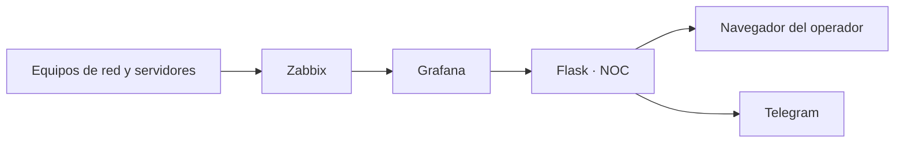

# NOC · Centro de Operaciones de Red

Panel web de monitoreo para la infraestructura de red. Toma los datos de **Zabbix** a través de **Grafana** y los muestra en una interfaz propia hecha con **Flask**: estado de equipos y puertos, alertas, eventos y un **plan de acción** para cada alerta.

> Proyecto académico · [Universidad] · [Programa] · Autor: [Nombre]

## Características

- Panel con indicadores: equipos en línea, enlaces activos, alertas y eventos.
- Bastidor y topología de red con el estado de cada puerto (incluye puertos de fibra).
- Alertas clasificadas por prioridad (P1, P2, P3) con **afectación, causas, solución y plan de acción** (13 guías).
- Notificaciones por **Telegram**.
- Usuarios, roles y permisos, auditoría y tokens de API.
- Seguridad: contraseñas con hash, bloqueo por intentos fallidos, protección CSRF, cookies seguras y HTTPS.
- Tema claro y oscuro. Funciona sin salida a internet.
- Despliegue con **Docker Compose**.

## Arquitectura



## Requisitos

- Servidor Linux con Docker y Docker Compose.
- Zabbix con un token de API.
- Grafana con el plugin `alexanderzobnin-zabbix-app` y un token de cuenta de servicio.
- (Opcional) Un bot de Telegram.

## Instalación

```bash
git clone https://github.com/TU-USUARIO/noc-monitoreo.git
cd noc-monitoreo
cp .env.example .env        # completa los valores con tus datos
docker compose up -d --build
```

Abre `https://IP-DEL-SERVIDOR/`, acepta la advertencia del certificado autofirmado y crea la cuenta de administrador en la pantalla de configuración inicial.

## Configuración

| Variable | Descripción |
|---|---|
| `GRAFANA_TOKEN` | Token de servicio de Grafana |
| `ZABBIX_API_URL` | Dirección de la API de Zabbix |
| `ZABBIX_API_TOKEN` | Token de la API de Zabbix |
| `ZABBIX_DS_UID` | UID de la fuente de datos de Zabbix en Grafana |
| `TELEGRAM_TOKEN`, `TELEGRAM_CHAT_ID` | Notificaciones (opcional) |
| `NOC_NOMBRE` | Nombre que se muestra en la interfaz |
| `NOC_CORS_ORIGEN` | Origen permitido para aplicaciones con token |
| `NOC_PUERTOS_OCULTOS` | Puertos del FortiGate que no quieres ver |

## Estructura

```
.
├── docker-compose.yml
├── .env.example
├── LICENSE
├── flask/
│   ├── Dockerfile
│   ├── app.py
│   └── requirements.txt
└── docs/          # documentación y capturas
```

## Seguridad

- Nunca subas el archivo `.env` ni la base de datos (`*.db`): están en `.gitignore`.
- Si un token se publica por error, revócalo y genera uno nuevo.

## Documentación

La documentación completa del proyecto está en la carpeta [`docs/`](docs/).

## Licencia

MIT. Ver el archivo [LICENSE](LICENSE).
